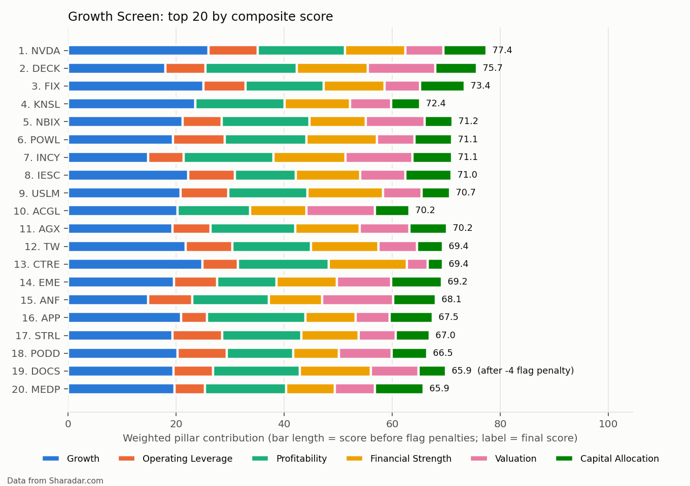

# AI Stock Screen

A Python screener for the U.S. stock market. It ranks every investable operating company with two multi-factor
screens, explains each red flag, and was tested against a holdout of companies never used during development.

- **Growth** looks for durable, profitable growth with operating leverage, a sound balance sheet and a reasonable valuation.
- **Income / Value** looks for dividends covered by earnings and cash flow, stable quality and a sensible valuation. It also detects yield traps.

> Screen scores are research inputs, not investment recommendations. A high rank means a company looks strong
> against its peers on these metrics. It does not mean the stock is undervalued.

**Status:** methodology frozen (fingerprint `fc2159212b4d7966`). Final run on Sharadar data as of 2026-10-07:
21,024 securities, 2,213 investable companies, 534 ranked on Growth and 504 on Income. 195 automated tests.

---

## What it does

```
 refresh (network)        build                    run                           outputs
┌──────────────────┐   ┌──────────────────┐   ┌───────────────────────────┐   ┌──────────────────────┐
│ providers/       │   │ metrics/engine   │   │ universe  → investable    │   │ full/      licensed  │
│  sharadar (paid) │──▶│ 125 metrics with │──▶│ profiles  → bank/REIT/... │──▶│ retained/  ratios    │
│  sec (EDGAR)     │   │ status codes     │   │ flags     → 20 red flags  │   │ public/    ranks,    │
│  synthetic       │   │ ok/missing/nm/   │   │ scoring   → peer-relative │   │            charts    │
└────────┬─────────┘   │ short            │   │             pillars       │   └──────────────────────┘
         ▼             └──────────────────┘   └───────────────────────────┘
 data/store/<provider>/<snapshot>/*.parquet   (local only, git-ignored, purged)
```

1. **Universe.** It starts from every U.S. security, then removes delisted names, ETFs, preferreds, warrants, SPACs, secondary share classes, micro-caps and illiquid or penny stocks, and companies with too little history. 21,024 securities become 2,213 investable companies.
2. **Metrics.** The engine defines **125 metrics**: 111 calculated ratios, growth rates and trends, 7 raw market and financial values, and 7 data-quality fields. They cover 1-, 3-, 5- and 8-year windows for growth, profitability, cash conversion, balance sheet, capital allocation, dividends and valuation. Each value carries a status code (`ok`, `missing`, `nm` = not meaningful, `short` = not enough history). Missing data is never silently filled with zero.
3. **Industry profiles.** Each company is assigned one of six profiles, which decides which metrics apply (see below).
4. **Red flags.** 20 rules check things such as negative earnings, falling margins, negative FCF, high or rising leverage, dilution, heavy stock-based compensation, weak dividend coverage, yield traps, dividend cuts, peak-cycle earnings and recent spin-offs. Each rule has a severity, and severe flags send a company to review instead of the ranking.
5. **Scoring.** Each company is ranked against its peers within each pillar. The pillars are combined into a 0–100 composite score; flag penalties come off and a confidence grade is attached. Every threshold and weight lives in YAML under `config/`.

### The two screens

| | Growth | Income / Value |
|---|---|---|
| Pillars (metrics scored) | Growth (6), Operating leverage (2), Profitability (5), Financial strength (4), Valuation (5), Capital allocation (2) | Dividend safety (5), Quality & stability (5), Dividend growth (3), Yield (2), Valuation (4), Growth (2) |
| Gates | 3-year revenue CAGR ≥ 8% and 1-year revenue growth ≥ 0% | Dividend yield ≥ 1.5% and ≥ 3 dividend-paying years |
| Emphasis | Revenue growth that turns into margin gains and cash flow, at a reasonable price | Dividends covered by earnings and FCF (FFO for REITs), with stable earnings and room to grow |
| Run on final data | 844 gate-eligible → 534 ranked, 310 needs review | 795 gate-eligible → 504 ranked, 291 needs review |

Methodology details: [docs/SCREENING_METHODOLOGY.md](docs/SCREENING_METHODOLOGY.md). Every output column: [docs/DATA_DICTIONARY.md](docs/DATA_DICTIONARY.md).

### Industry-specific treatment

Applying one set of metrics to every business gives misleading results, so each profile has its own.

| Profile | What changes |
|---|---|
| **Bank** (banks, mortgage REITs, bank-funded financials) | EV, EBITDA, FCF, gross/operating margin and net-debt measures are n/a, because deposits are funding, not debt. Uses ROA, ROE on common equity, equity/assets, P/TBV and P/B |
| **Insurance** (carriers) | Operating cash flow includes float, so FCF, net debt, EV/EBITDA and ROIC are n/a. Uses ROE on average common equity and growth in book value per share, both reported and ex-AOCI. Brokers and managed-care plans are scored as normal businesses |
| **REIT** | P/FFO instead of P/E, FFO payout instead of earnings payout, FFO/share growth instead of EPS growth, net debt/EBITDAre. FCF is n/a because standardized capex includes property acquisitions. Impairments and property-sale gains come from SEC filings, including company-specific XBRL concepts |
| **Utility** | Rate-base capex exceeds operating cash flow by design, so FCF metrics are n/a. Pipelines, waste haulers and independent power producers are excluded |
| **Cyclical** (energy, materials, semis, autos, homebuilders, machinery, shipping) | Valuation is scored on normalized earnings (8-year average margins × current revenue), and a cyclical-peak flag is severe in Growth. Structural growers with a steady revenue record exit to the default profile (e.g. NVIDIA) |
| **Default** | Everything else |

## Data architecture: Sharadar + SEC EDGAR

| Provider | Role | License |
|---|---|---|
| **Sharadar Core US Equities Bundle** (Nasdaq Data Link) | Production data: 10 years of fundamentals, daily prices and market caps for the whole U.S. market, including delisted companies | Personal use. Raw data stays local and is deleted within 30 days of cancelling ([DATA_LICENSING](docs/DATA_LICENSING.md)) |
| **SEC EDGAR** (companyfacts API + 10-K XBRL instances) | Independent reference for validation, plus fields Sharadar lacks (REIT impairments and gains) | Public domain |
| **Synthetic** | 60 fictional companies built to exercise every rule; used for tests and the demo | Public |

- Each provider converts its data to one schema (`screener/schema.py`), so the engine never needs to know where the data came from.
- `refresh` is the only command that uses the network. Everything else runs from local snapshots.
- Outputs come in three tiers so licensed data never leaves the machine:
  - `full/`: raw licensed values. Local only, purged.
  - `retained/`: derived ratios. Local only.
  - `public/`: ranks, scores, flag names and charts. Publishable.
- `check-public` and a pre-commit hook enforce the split.

## Validation methodology

The rules were tuned on a development set of companies and then **frozen** before any out-of-sample testing. The
freeze writes a fingerprint covering flags, profiles, screens, weights and universe settings. After the freeze, only
objective data, parsing and calculation fixes were allowed, and each had to leave the fingerprint unchanged.

1. **Data accuracy.** Sharadar was checked against SEC EDGAR for 30 validation companies over 10 years. Share of company-years within 2%: operating cash flow and total assets 100%, equity 99.7%, net income 99.0%. Revenue matched 96.1% of company-years across all SEC-checked companies once the SEC parser was fixed.
2. **152-company holdout.** The holdout was drawn *after* the freeze from the 2,010 investable companies outside the development set. It was stratified by profile and size (seed 20261008, checksum `89500a4fafc15b9e`) and evaluated against criteria registered in advance ([HOLDOUT_PROTOCOL](docs/HOLDOUT_PROTOCOL.md)). Result: **9 of 9 automatic criteria passed.**
   - Data accuracy on unseen names held up.
   - Profile assignment was correct for 151/152.
   - Red-flag and needs-review rates were in line with the rest of the universe.
   - Under ±20% changes to pillar weights, the ranking barely moved: median Spearman correlation 0.998 (Growth) / 0.996 (Income), and median top-quintile overlap 100%.
3. **20-company manual 10-K audit.** Profile, key financials and flags were checked by hand against each company's latest 10-K and 10-Qs. The 20 were the top 5 per screen, 5 needs-review names and 5 random. Result: **20/20 in every column** (criterion ≥ 90%).
4. **REIT FFO reconciliation.** Screen FFO/share was compared with company-reported NAREIT FFO for 33 REITs: 26 within 10%, median gap 4.7%. Each larger gap is bridged line by line ([REIT_FFO_RECONCILIATION](docs/REIT_FFO_RECONCILIATION.md)).

The canonical holdout results (criteria, match rates, audit verdicts and pass rates) are published in
[`validation/holdout_2026-10-08/`](validation/holdout_2026-10-08/).

Fixes made after the freeze are logged with dates and effects in [VALIDATION_REPORT](docs/VALIDATION_REPORT.md):
- An SEC revenue-tag parser fix.
- REIT gains reported under company-extension XBRL concepts.
- Zero dividends-paid vendor records.

Where a fix touched holdout companies, the contamination is documented rather than hidden, and the holdout was never redrawn.

## Example output (final run, data as of 2026-10-07)

GitHub-safe sample outputs are in [`portfolio/`](portfolio/):
- `2026-10-07_sharadar/`: the real run. Ranks, scores, pillar scores, flag names and sector medians only.
- `2026-09-30_synthetic/`: the demo universe.



| # | Growth | Score | | # | Income / Value | Score |
|---|---|---|---|---|---|---|
| 1 | NVDA · NVIDIA | 77.4 | | 1 | HRB · H&R Block | 76.6 |
| 2 | DECK · Deckers Outdoor | 75.7 | | 2 | OZK · Bank OZK (bank) | 73.3 |
| 3 | FIX · Comfort Systems USA | 73.4 | | 3 | KRG · Kite Realty (REIT) | 71.4 |
| 4 | KNSL · Kinsale Capital (insurance) | 72.4 | | 4 | KFY · Korn Ferry | 71.3 |
| 5 | NBIX · Neurocrine Biosciences | 71.2 | | 5 | UFPI · UFP Industries (cyclical) | 71.0 |

More charts: [Income top 20](portfolio/2026-10-07_sharadar/charts/income_top20_pillars.png) ·
[universe funnel](portfolio/2026-10-07_sharadar/charts/universe_funnel.png) ·
[score distributions](portfolio/2026-10-07_sharadar/charts/).

Research notes on ten of these names keep the screen output separate from any investment thesis. One example:
Edison International ranks highly partly on one-off wildfire-fund recoveries.

## Project evolution

This version is a full rebuild of an earlier prototype. The prototype was a single script that scored S&P 500
companies on a few vendor-supplied ratios. The rebuild added:
- a provider-neutral data layer;
- the full U.S. market from 10 years of fundamentals;
- industry-specific profiles, red flags and peer-relative scoring;
- license-compliant output tiers;
- a frozen methodology validated on a holdout.

The prototype code is not part of this repository.

## Limitations

- **Relative scores.** A score ranks a company against its peers; it is not a valuation.
- **No return backtest.** Testing whether the rankings predict returns needs point-in-time data including delisted companies, which was outside this project's scope.
- **Standardized data.** Bank KPIs such as net interest margin, efficiency ratio, CET1 and credit losses are not available. Insurance KPIs are not available either.
- **REIT FFO is approximate.** It uses total rather than real-estate D&A and has no joint-venture share or discontinued-operations adjustment. Equinix reads +31% and Crown Castle −35% against company figures.
- **Trailing data looks backward.** One-off gains in trailing figures can flatter margins and P/E (PTC, Edison International). Predecessor history can distort 10-year averages (Howmet). Consecutive special dividends can read as a cut.
- **Vendor labels can be stale.** Uniti Group is still labelled a REIT after it stopped qualifying in 2025.
- **Small special profiles in the holdout.** With 6 REITs, 5 insurers and 4 utilities, results for those profiles are indicative only.

Changing any of these is a methodology revision: it needs a new freeze and a new, never-inspected holdout.

## Quick start

```bash
python3 -m venv .venv && source .venv/bin/activate
pip install -r requirements.txt
python -m screener demo          # fictional companies, no API key needed
python -m pytest -q              # 195 tests
cp scripts/pre-commit .git/hooks/pre-commit && chmod +x .git/hooks/pre-commit   # publish guard
```

To use real data, copy `.env.example` to `.env` and add `SEC_USER_AGENT` (free) and optionally `SHARADAR_API_KEY`.
The subscription-month workflow is in [docs/SUBSCRIPTION_MONTH_PLAN.md](docs/SUBSCRIPTION_MONTH_PLAN.md).

## Commands

| Command | What it does |
|---|---|
| `python -m screener status` | Shows stored data, its age and each provider's license rule |
| `python -m screener refresh --provider sec --tickers AAPL,MSFT,JPM` | Downloads SEC EDGAR fundamentals (free) |
| `python -m screener check-key` | Confirms the paid Sharadar key works, without downloading |
| `python -m screener refresh --provider sharadar` | Full-market bulk download |
| `python -m screener universe --provider sharadar` | Validates the downloaded universe before screening |
| `python -m screener run [--provider P] [--screen growth]` | Runs the screens and writes the three output tiers |
| `python -m screener company NVDA` | Every metric, status, flag and score for one company |
| `python -m screener validate --primary sharadar --reference sec --tickers-file list.txt` | Compares provider financials with SEC filings |
| `python -m screener freeze [--verify]` / `holdout draw` / `holdout evaluate` | Methodology freeze and holdout validation |
| `python -m screener check-public` | Checks that nothing licensed and no API keys would be published |
| `python -m screener export-portfolio` | Copies the latest public tier to `portfolio/` |
| `python -m screener purge --provider sharadar` | Deletes licensed raw and normalized data, keeping retained and public outputs |

## Project layout

```
config/          settings · flags · industry_profiles · screens/{growth,income} · freeze record · holdout list
screener/
  providers/     base · synthetic · sec · sharadar      (the only network code)
  metrics/       registry (definitions) · engine · robust growth · split adjustment
  universe.py · profiles.py · flags.py · scoring.py · supplement.py (SEC → Sharadar REIT fields)
  outputs.py · compliance.py (purge, check-public, export) · holdout.py · validate.py · cli.py
tests/           195 tests: metrics, profiles, flags, scoring, providers, parser regressions, holdout, licensing
docs/            methodology · data dictionary · validation report · holdout protocol · REIT reconciliation · licensing
portfolio/       GitHub-safe sample outputs (public tier only)
validation/      published holdout results: criteria, summary, manual 10-K audit verdicts
```

## Documentation

- [Project summary](docs/PROJECT_SUMMARY.md): frozen output set and key numbers
- [Screening methodology](docs/SCREENING_METHODOLOGY.md)
- [Validation report](docs/VALIDATION_REPORT.md) and [holdout protocol](docs/HOLDOUT_PROTOCOL.md)
- [REIT FFO reconciliation](docs/REIT_FFO_RECONCILIATION.md)
- [Data dictionary](docs/DATA_DICTIONARY.md)
- [Data licensing and purge procedure](docs/DATA_LICENSING.md)

Python 3.9+ with pandas, numpy, pyarrow, PyYAML and requests. matplotlib (charts) and pytest are optional.
Price and fundamental data in `portfolio/2026-10-07_sharadar/` are derived from Sharadar ([sharadar.com](https://sharadar.com/)).
